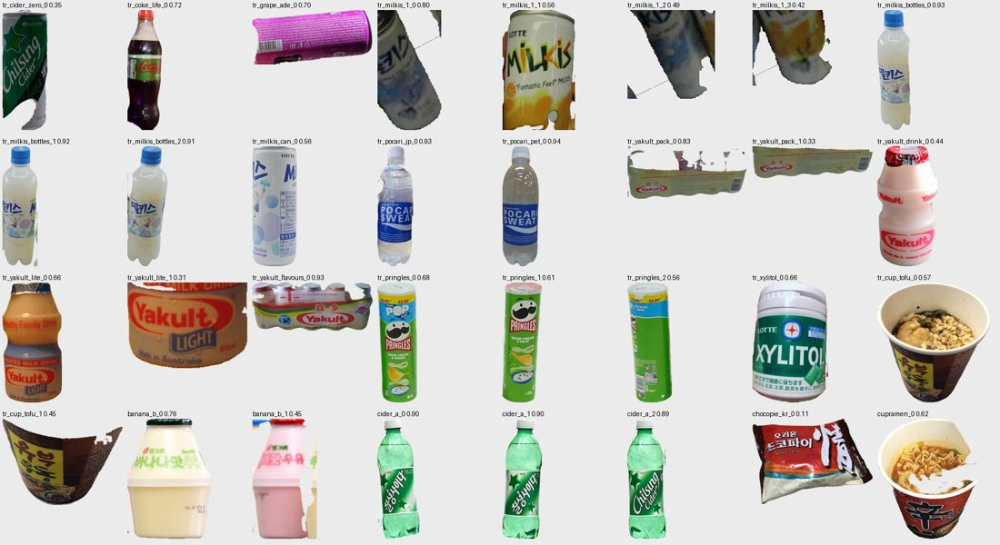
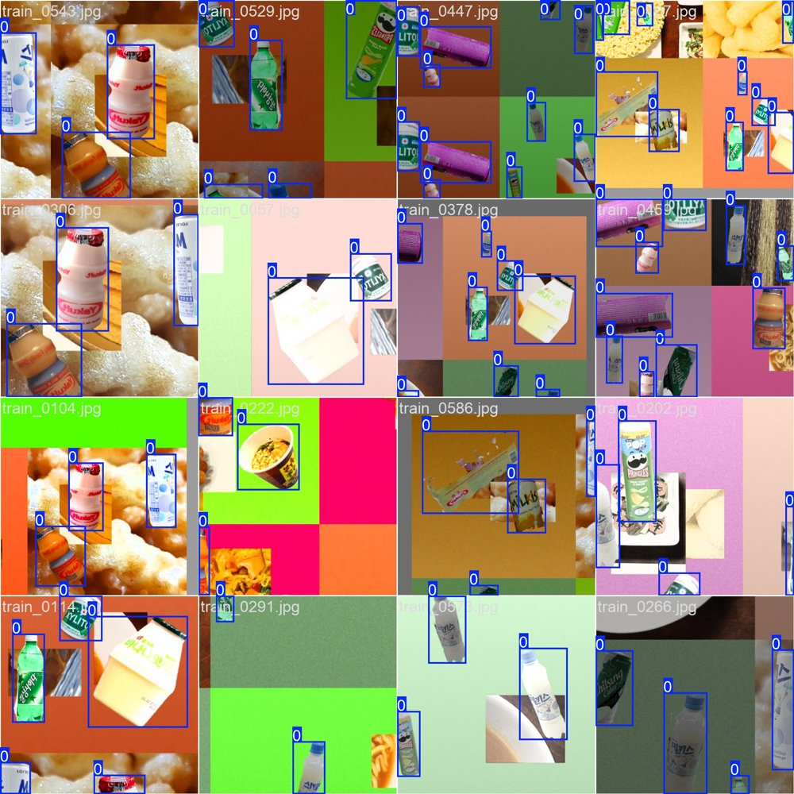
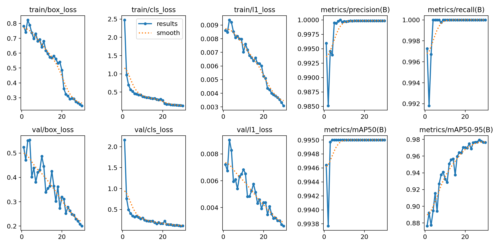
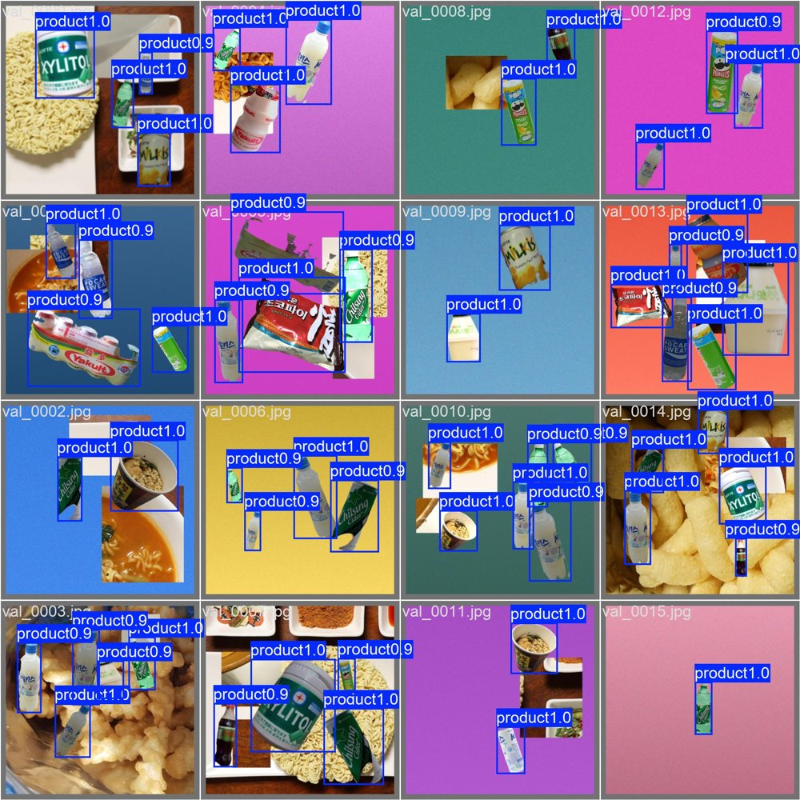
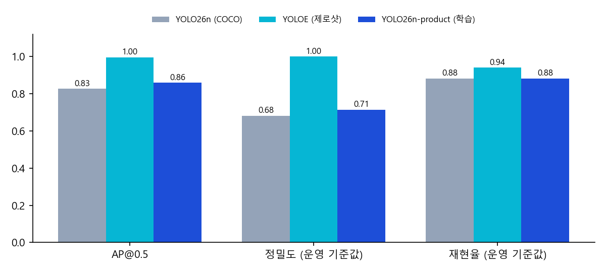
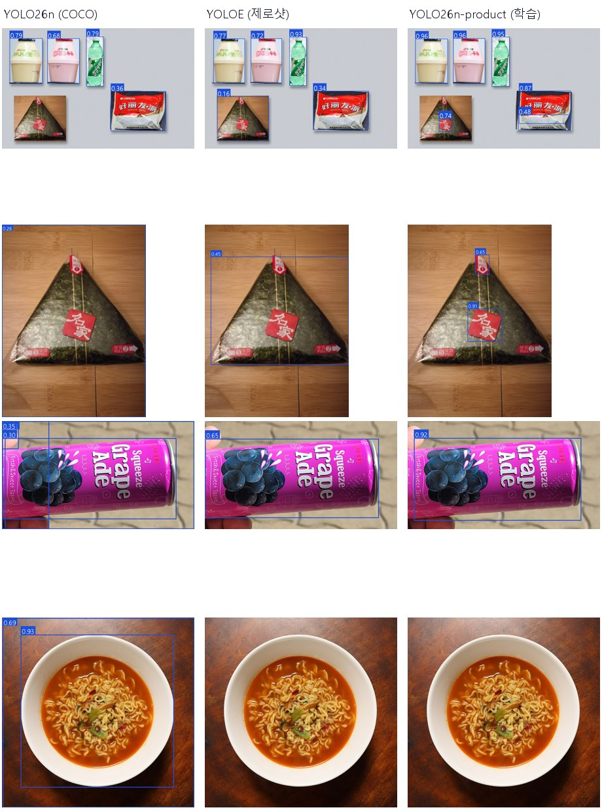

# 모델 학습 결과 보고서
### YOLO26n '상품' 검출기 — 자동 라벨링·합성 데이터 학습과 제로샷 YOLOE 비교

> 청년 피지컬AI 일경험 프로젝트 1기 · 스캔앤고(SCAN&GO)
> 작성일: 2026-10-13 · 작성자: 임우진 · 관련 문서: [모델 검토 보고서](report.html) 3.5절

---

## 0. 요약

| 항목 | 내용 |
|---|---|
| 목적 | 상품의 **위치만** 찾는 1클래스 검출기를 직접 학습해, 지금 쓰는 제로샷 검출기 YOLOE를 대신할 수 있는지 확인 |
| 데이터 | 공개 사진 32장 → YOLOE 마스크로 자동 라벨링 → 사람 검수로 상품 조각 25개 → 합성 사진 **700장** (학습 600 / 검증 100) |
| 학습 | COCO 사전학습 YOLO26n → 1클래스 전이학습, 512px, 30에폭, CPU 약 42분 |
| 합성 검증 | mAP50 **0.995**, mAP50-95 **0.979** |
| 실제 사진 평가 | AP&#64;0.5 **0.86** (YOLOE 0.997, 학습 전 COCO 모델 0.83) · 속도 **30ms** (YOLOE 98ms) |
| 전체 파이프라인 | 합계 **3,700원** (정답 4,300원) → 틀림 |
| **결론** | **YOLOE를 계속 쓴다.** 학습 모델은 3배 빠르지만 합성 데이터에 과적합했다. PoC에서 실제 매장 사진으로 다시 학습한 뒤, 같은 평가에서 YOLOE를 넘으면 바꾼다. |

---

## 1. 왜 학습했나

모델 검토 보고서 2.3절의 원칙은 "**제로샷으로 먼저 검증하고, 부족하면 YOLO26 커스텀 학습으로 승격한다**"이다. 제로샷 YOLOE로 만든 파이프라인에는 두 가지 약점이 있었다.

1. **처음 보는 한국 상품에 약하다.** 삼각김밥은 `seaweed wrapped rice` 프롬프트로 0.16을 겨우 넘었고, `rice ball`·`onigiri`로는 아예 잡히지 않았다. 문구 하나에 결과가 크게 달라진다.
2. **느리다.** YOLOE-26s는 개발 PC CPU에서 한 장에 약 100ms가 걸린다. 매장 PC는 이보다 약할 수 있다.

학습 대상은 **상품 2,000종 분류기가 아니라 '상품' 1클래스 검출기**로 정했다. 무슨 상품인지는 지금처럼 SigLIP 2 갤러리가 판별하므로, 신상품이 나와도 이 검출기는 다시 학습할 필요가 없다. "재학습 없이 신상품 추가"라는 A안의 장점을 그대로 지킬 수 있다.

---

## 2. 데이터 만들기 — 사람이 박스를 그리지 않음

코드: `src/make_train_data.py` (`cutouts` → `synth` 두 단계)

### 2.1 사진 수집

Wikimedia Commons에서 자유 라이선스 사진을 받았다. 출처는 [CREDITS.md](CREDITS.md)에 있다.

| 구분 | 장수 | 내용 | 쓰임 |
|---|---|---|---|
| 상품 (양성) | 19 | 병·캔·봉지·컵 (밀키스, 포카리, 요구르트, 프링글스, 자일리톨, 컵라면 등 15장) + 등록 사진 원본 4장 | 오려 내서 합성 |
| 상품 아님 (음성) | 13 | 조리한 신라면, 과자 내용물(쫀드기, 꿀꽈배기, 바나나킥 등) | 배경과 라벨 없는 방해물 |
| 평가 전용 | 6 | 중국판 요구르트·포카리, 손에 든 포도 에이드, 음식 사진 3장 | 학습에 쓰지 않음 |

**학습과 평가를 섞지 않는 원칙:** 홈페이지에 나오는 테스트 사진(계산대 합성, 바나나우유, 사이다, 중국판 초코파이, 삼각김밥)은 학습에 쓰지 않았다. 특히 **삼각김밥은 비슷한 종류도 학습에 넣지 않아**, 처음 보는 상품에 일반화되는지 보도록 했다.

### 2.2 자동 라벨링 (YOLOE 분할 마스크)

YOLOE-26s-seg에 `bottle`, `can`, `snack package`, `cup noodle`, `plastic container`, `drink` 프롬프트를 주고, 분할 마스크로 상품만 투명 배경 PNG로 오려 냈다. 검출이 없으면 기준값을 0.05로 낮춰 가장 확실한 하나만 받았다. 결과는 **32조각**이었다.



### 2.3 사람 검수

확인용 시트를 보고 **7조각을 뺐다** (`data/train/exclude.json`). 마스크가 상품 일부만 잘랐거나 배경이 섞인 조각, 그리고 테스트 상품과 같은 종류인 딸기우유다. 남은 **25조각**(원본 19장)으로 학습했다. 박스를 하나하나 그리는 대신 시트 한 장을 보는 데 몇 분이면 된다.

| 제외한 조각 | 이유 |
|---|---|
| `tr_milkis_1_0`, `_2`, `_3` | 손·배경 일부만 잘림 |
| `tr_yakult_pack_1`, `tr_yakult_lite_1` | 포장 일부만 잘림 |
| `tr_cup_tofu_1` | 컵 일부만 잘림 |
| `banana_b_1` | 딸기우유 — 테스트 상품과 같은 종류 |

### 2.4 합성

사진 한 장마다 다음을 무작위로 정했다. 박스 라벨은 조각을 붙인 위치에서 자동으로 계산하므로 정확하다.

- **배경:** 단색·그라데이션에 노이즈, 또는 35% 확률로 음식 사진 질감
- **방해물:** 음식 사진 조각 0\~2개를 **라벨 없이** 붙임 → "사각형 조각이면 상품"이라는 지름길 학습을 막음
- **상품:** 2\~6개, 높이는 사진의 18\~50%, 회전 ±35°, 밝기 0.7\~1.3배, 서로 20% 넘게 겹치지 않게
- **흐림:** 일부 사진에 가우시안 블러
- 크기 640×640, **학습 600장 / 검증 100장**



---

## 3. 학습

코드: `src/train_yolo26.py`

| 설정 | 값 | 이유 |
|---|---|---|
| 시작 가중치 | `yolo26n.pt` (COCO 사전학습) | 병·컵 같은 형태를 이미 알고 있음 |
| 클래스 | 1개 (`product`) | 종류 판별은 SigLIP 2가 함 |
| 입력 크기 | 512px | CPU 학습 시간 단축 (GPU면 640 권장) |
| 에폭 / 배치 | 30 / 16 | patience 15 |
| 최적화 | AdamW, lr0 0.002 (자동 선택) | |
| 증강 | Ultralytics 기본 (모자이크, 좌우 반전, HSV, 크기 ±50%), 마지막 10에폭은 모자이크 끔 | |
| 장비 | 개발 PC CPU (Ryzen 5 8500G) | 에폭당 약 80\~90초, 합계 약 42분 |

학습 중 메모리 부족으로 **10에폭에서 한 번 멈췄고**, 마지막 체크포인트에서 `resume`으로 이어서 30에폭까지 마쳤다. 가장 좋은 가중치(`best.pt`)는 27에폭이다.

### 3.1 학습 곡선

| 에폭 | box 손실 (학습) | cls 손실 (학습) | 검증 mAP50 | 검증 mAP50-95 |
|---|---|---|---|---|
| 1 | 0.78 | 2.48 | 0.995 | 0.876 |
| 10 | 0.64 | 0.38 | 0.995 | 0.933 |
| 20 | 0.49 | 0.27 | 0.995 | 0.970 |
| 27 (best) | 0.27 | 0.14 | 0.995 | **0.979** |
| 30 | 0.25 | 0.12 | 0.995 | 0.976 |



**읽는 법:** 검증 mAP50이 **첫 에폭부터 0.995**다. 검증 사진도 학습 사진과 같은 방식으로 합성했기 때문에 문제가 너무 쉽다는 뜻이다. 이후 에폭에서는 박스를 더 꼭 맞게 그리는 것(mAP50-95 0.88 → 0.98)만 좋아졌다. 그래서 **합성 검증 점수로는 실제 성능을 알 수 없고**, 실제 사진으로 따로 평가해야 한다.



---

## 4. 실제 사진 평가

코드: `src/eval_detectors.py` · 평가 세트: `data/eval_set.json`

### 4.1 평가 방법

- **학습에 쓰지 않은 사진 11장, 정답 박스 17개** (사람이 표시)
  - 합성 계산대 1장 (상품 5개)
  - 실제 상품 사진 7장: 바나나우유 4개, 작은 사이다 3개, **삼각김밥(학습에 없던 종류)**, 중국판 초코파이·요구르트·포카리, 손에 든 캔
  - **상품이 없는 음식 사진 3장**: 조리한 라면, 과자 내용물 2장 → 오검출을 본다
- **AP&#64;0.5:** 예측 박스와 정답 박스가 50% 넘게 겹치면 맞음. 모든 사진의 예측을 점수순으로 모아 정밀도-재현율 곡선 아래 넓이를 잰다 (VOC 방식).
- **정밀도·재현율·오검출:** 각 모델을 실제로 쓸 때의 기준값으로 잰다 (YOLOE 0.15, 나머지 0.25).
- **속도:** 같은 CPU, 워밍업 후 11장 평균

### 4.2 결과

| 검출기 | 합성 검증 mAP50 | **실제 AP&#64;0.5** | 정밀도 | 재현율 | 맞춤 / 17 | 오검출 | 속도 (CPU) |
|---|---|---|---|---|---|---|---|
| YOLO26n (COCO, 학습 없음) | – | 0.83 | 0.68 | 0.88 | 15 | 7 | 44 ms |
| **YOLOE-26s (제로샷)** | – | **0.997** | **1.00** | **0.94** | **16** | **0** | 98 ms |
| YOLO26n-product (직접 학습) | 0.995 | 0.86 | 0.71 | 0.88 | 15 | 6 | **30 ms** |



### 4.3 사진별 결과 (맞춤 / 오검출)

| 사진 | 정답 | COCO | YOLOE | 학습 모델 |
|---|---|---|---|---|
| 합성 계산대 | 5 | 4 / 0 | **5 / 0** | 4 / 2 |
| 바나나우유 4개 | 4 | 4 / 0 | 4 / 0 | 4 / 0 |
| 작은 사이다 3개 | 3 | 3 / 0 | 3 / 0 | 3 / 0 |
| 삼각김밥 (처음 보는 종류) | 1 | 1 / 0 | 1 / 0 | **0 / 2** |
| 중국판 초코파이 | 1 | 0 / 0 | 0 / 0 | 1 / 1 |
| 중국판 요구르트 | 1 | 1 / 0 | 1 / 0 | 1 / 0 |
| 중국판 포카리 | 1 | 1 / 1 | 1 / 0 | 1 / 1 |
| 손에 든 캔 | 1 | 1 / 3 | 1 / 0 | 1 / 0 |
| 조리한 라면 (상품 없음) | 0 | 0 / 2 | 0 / 0 | **0 / 0** |
| 과자 내용물 (상품 없음) | 0 | 0 / 1 | 0 / 0 | **0 / 0** |
| 과자 (상품 없음) | 0 | 0 / 0 | 0 / 0 | 0 / 0 |



### 4.4 전체 파이프라인에 넣어 본 결과

같은 계산대 사진(정답: 상품 5개, 4,300원, 바코드 요청 2건)을 `scan_and_go.py`로 돌렸다.

| 검출기 | 검출 단계 | 전체 시간 | 합계 | 처리 결과 |
|---|---|---|---|---|
| **YOLOE (기본)** | 102 ms | 2.6초 | **4,300원 (정답)** | 인식 3 + 바코드 요청 2 → 5개 모두 올바름 |
| 직접 학습 (`--detector product`) | 27 ms | 2.1초 | **3,700원 (틀림)** | 인식 2 + 바코드 요청 4 → 초코파이를 놓침 |

학습 모델로 바꾸면 초코파이 봉지를 **박스 두 개로 쪼개** 잡았다. 조각마다 SigLIP 2 유사도가 0.73, 0.74로 기준(0.75)에 못 미쳐 미등록 상품으로 처리됐고, 그만큼 합계가 600원 빠졌다. 삼각김밥 자리에서는 김밥 전체가 아니라 작은 조각을 잡았는데, 바코드 요청으로 넘어가 결과적으로는 맞게 처리됐다.

---

## 5. 해석

### 5.1 왜 실제 사진에서 떨어졌나 — 합성 데이터 과적합

- **다양성 부족.** 상품 조각 25개(원본 사진 19장)뿐이다. 모델은 "상품이란 무엇인가"보다 "이 25개 모양"을 외웠다.
- **처음 보는 형태를 일반화하지 못했다.** 삼각형 김밥은 학습에 없는 모양이라, 전체 대신 **색 있는 라벨 스티커**를 상품으로 잡았다. 학습한 병·캔에는 대부분 색 있는 라벨이 붙어 있기 때문으로 보인다.
- **잘라 붙인 경계에 익숙하다.** 합성 사진에서는 상품 테두리가 배경과 확연히 다르다. 실제 사진처럼 봉지가 구겨져 경계가 흐리면 초코파이처럼 박스를 쪼갠다.
- **합성 검증은 이 문제를 못 잡는다.** 첫 에폭부터 0.995였다. 실제 사진 평가 세트를 따로 둔 것이 이번 실험에서 가장 중요한 결정이었다.

### 5.2 잘한 점

- **음식 사진 오검출 0건.** COCO 모델은 조리한 라면 사진에서 2건, 과자 내용물 사진에서 1건을 잘못 잡았다. 음식 사진을 라벨 없는 방해물로 넣은 효과다.
- **아는 종류는 확실하게 잡는다.** 바나나우유·사이다·요구르트처럼 학습한 형태와 비슷한 상품은 모두 맞췄다.
- **YOLOE보다 3배 빠르다** (30ms vs 98ms). 매장 PC가 약하거나 카메라가 여러 대일 때 큰 장점이다.
- **사람 손이 거의 들지 않는다.** 박스를 그리지 않고 시트 한 장을 검수했을 뿐이다.

### 5.3 이 실험의 한계

- 평가 세트가 11장(정답 17개)으로 작다. 사진 한두 장에 따라 AP가 크게 움직인다.
- 실제 계산대 사진이 아니라 공개 사진과 합성 사진이다. 매장 조명·트레이·카메라 각도는 반영하지 못했다.
- 한 번만 학습했다 (seed 0). 증강이나 데이터 비율을 바꿔 가며 비교하지 않았다.

---

## 6. 결론과 다음 단계

**결론: 상품 위치 검출은 계속 YOLOE가 맡는다.** 직접 학습한 모델은 실제 사진에서 YOLOE보다 낮고(AP 0.86 vs 0.997), 전체 파이프라인에서 금액이 틀렸다. 다만 속도와 오검출 억제 면에서 가능성을 확인했다.

**승격 조건:** 같은 평가 세트(와 PoC에서 늘린 평가 세트)에서 **AP&#64;0.5와 재현율이 YOLOE 이상**이고, 전체 파이프라인 합계가 맞을 때 학습 모델로 바꾼다.

**다음 단계 (PoC)**

1. 시범 매장 계산대에서 **실제 트레이 사진 수백 장** 수집 (조명·각도·상품 조합 다양하게)
2. **YOLOE로 자동 라벨링 → 사람 검수** (이번과 같은 방식, 박스 수정만)
3. 실제 사진 + 합성 사진을 섞어 재학습 (GPU, 640px)
4. 평가 세트를 실제 사진 100장 이상으로 늘려 YOLOE와 다시 비교
5. 통과하면 매장 PC에 배포하고 YOLOE는 서버 쪽 라벨링·검증용으로 남김

데이터 생성·학습·평가 코드는 그대로 다시 쓸 수 있다.

---

## 7. 재현 방법

```bash
python src/prepare_samples.py            # 공개 사진·등록 사진 내려받기
python src/make_train_data.py cutouts    # YOLOE 마스크로 자동 라벨링 -> data/train/cutouts_sheet.jpg 확인
python src/make_train_data.py synth      # 합성 학습 데이터 700장
python src/train_yolo26.py               # YOLO26n 전이학습 (CPU 약 42분, GPU면 --device 0)
python src/eval_detectors.py             # 실제 사진 11장으로 3종 비교
python src/scan_and_go.py --detector product   # 학습 모델로 전체 파이프라인
```

| 결과물 | 위치 |
|---|---|
| 학습 가중치 (5MB, 저장소에는 올리지 않음) | `models/yolo26n-product.pt` |
| 평가 수치 | [`docs/images/eval_result.json`](images/eval_result.json) |
| 파이프라인 결과 | [`docs/images/scan_result_product.json`](images/scan_result_product.json) |
| 학습 곡선·그림 | `docs/images/train_results.png`, `docs/images/train/` |
