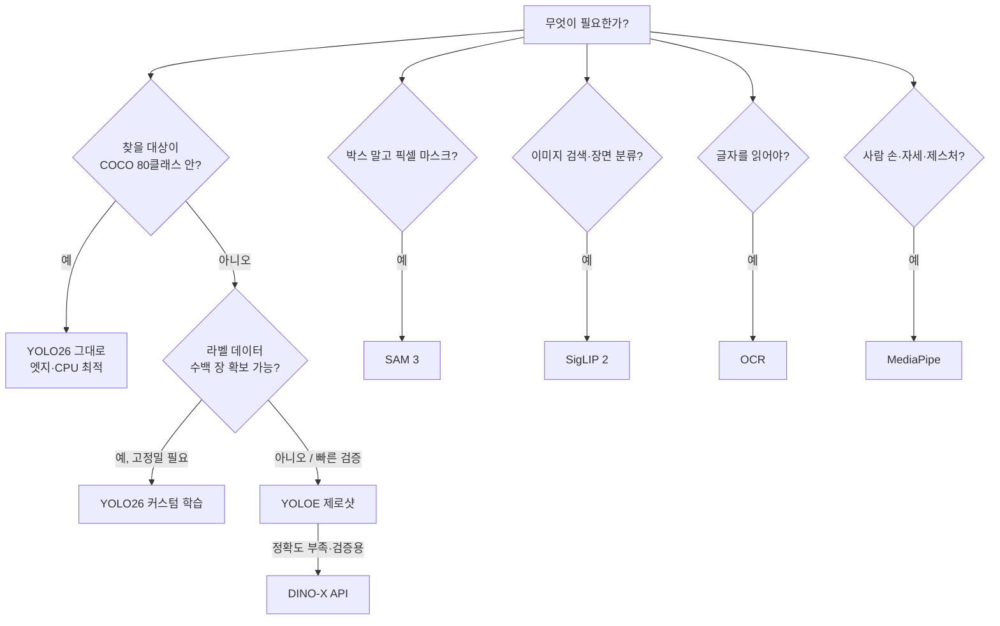

# 신규 비전 모델 검토 보고서
### YOLOE · DINO-X · SAM 3 · SigLIP 2 · OCR · MediaPipe — 기능, 사용 예시, 프로젝트 적용 판단

> 청년 피지컬AI 일경험 프로젝트 1기 · Track B2 (5~7차시) 학습 내용 정리
> 작성일: 2026-10-12 · 작성자: 임우진

---

## 0. 요약 (TL;DR)

| 모델 | 한 줄 정의 | 출력 | 학습 필요 | 실행 위치 | 라이선스·비용 |
|---|---|---|---|---|---|
| **YOLO26** (기존) | COCO 80클래스 실시간 검출기 | 박스·클래스·conf | 80클래스 밖은 커스텀 학습 필요 | 엣지(Pi 5 CPU) | AGPL-3.0 |
| **YOLOE** | 텍스트로 찾을 대상을 정하는 실시간 검출·분할기 | 박스·마스크·conf | ❌ (제로샷) | 엣지/로컬 GPU | AGPL-3.0 (Ultralytics) |
| **DINO-X** | 최고 정확도 오픈월드 검출 (클라우드 API) | 박스·마스크·키포인트·캡션 | ❌ | 클라우드 API | 상용 API (토큰·종량제) |
| **SAM 3** | 텍스트 개념 하나로 해당 객체 **전부**를 분할·추적 | 픽셀 마스크·ID | ❌ | GPU 권장 | SAM License, 가중치 접근 승인 필요 (HF) |
| **SigLIP 2** | 이미지·텍스트를 같은 벡터공간에 임베딩 | 임베딩 벡터·유사도 | ❌ | 로컬 CPU/GPU | Apache-2.0 |
| **OCR (easyocr)** | 사진 속 글자를 좌표+텍스트로 추출 | (박스, 글자, conf) | ❌ | 로컬 CPU/GPU | Apache-2.0 |
| **MediaPipe** | 손 21점·몸 33점·제스처 인식 (온디바이스) | 랜드마크 좌표·제스처명 | ❌ | 엣지/모바일 | Apache-2.0 |

**핵심 메시지:** YOLO26은 "정해진 80개 클래스"를 빠르게 잡는 데 최적이다. 오늘 배운 모델들은 **학습 없이(제로샷)** ① 새로운 대상을 말로 찾고(YOLOE·DINO-X), ② 픽셀 단위로 정밀 분할하고(SAM 3), ③ 이미지를 검색·분류하고(SigLIP 2), ④ 글자를 읽고(OCR), ⑤ 사람의 손·자세를 읽는(MediaPipe) 능력을 더해 준다.

---

## 1. 모델별 기능 및 사용 예시

### 1.1 YOLOE — 실시간 오픈보캐뷸러리 검출 ("Real-Time Seeing Anything")

**기능**
- 미리 정한 80개 클래스에 갇히지 않고, **텍스트 프롬프트**로 찾을 대상을 지정한다 (예: `"hard hat"`, `"traffic cone"`).
- 세 가지 프롬프트 방식: **텍스트** / **비주얼**(예시 박스) / **프롬프트 프리**(내장 4,585개 어휘, `*-seg-pf.pt`).
- 검출과 동시에 인스턴스 분할 마스크도 출력한다.
- `ultralytics` 패키지 안에 포함되어 있어서 YOLO26과 거의 같은 코드로 쓸 수 있다.

**동작 원리:** 텍스트를 임베딩(텍스트 인코더)으로 바꾸고, 그 임베딩이 곧 "클래스"가 된다. `set_classes()` 한 줄로 검출 어휘가 통째로 바뀌며, 재학습은 하지 않는다.

**사용 예시 코드**
```python
from ultralytics import YOLOE

model = YOLOE("yoloe-26s-seg.pt")              # 첫 실행 시 가중치 자동 다운로드
model.set_classes(["person", "hard hat"])      # '말'이 곧 클래스 (재학습 0)

results = model.predict("site.jpg", conf=0.50) # 0.50 미만 검출은 버림
for b in results[0].boxes:
    print(model.names[int(b.cls)], round(float(b.conf), 2))
results[0].save("site_yoloe.png")
```

**실습 결과 (교재 기준, 라벨 데이터 0장)**
| 프롬프트 | 결과 |
|---|---|
| `["person"]` | 작업자 4명 |
| `["person", "hard hat"]` | 사람 4 · 안전모 3 |
| `["traffic cone"]` | 고깔 1 (COCO에 없는 클래스) |
| conf 0.50 임계값 | 7개 중 5개 keep, 2개 drop (0.47 / 0.34) |

**활용 예시:** 건설 현장 안전모 미착용 감지, 공장 내 특정 부품·공구 검출, 클래스가 자주 바뀌는 프로토타입 단계.
**한계·주의:** 희귀한 도메인 특화 객체에서는 흔들릴 수 있다 → 그럴 때는 YOLO26 커스텀 학습으로 넘어간다. 첫 `set_classes()` 호출 때 텍스트 인코더(MobileCLIP2, 약 242MB)와 `clip` 패키지를 내려받으므로 네트워크가 필요하다 (실측).

---

### 1.2 DINO-X — 최고 정확도 오픈월드 검출 (IDEA Research)

**기능**
- 텍스트·비주얼 프롬프트, 또는 `"<prompt_free>"` 모드로 **이미지 속 모든 객체**를 검출한다.
- 박스뿐 아니라 **분할 마스크, 포즈 키포인트, 객체 캡션**까지 한 번에 낼 수 있다.
- **클라우드 API**로만 제공된다 (DeepDataSpace에서 토큰 발급, `dds-cloudapi-sdk`).

**사용 예시 코드**
```python
from dds_cloudapi_sdk import Config, Client
from dds_cloudapi_sdk.image_resizer import image_to_base64
from dds_cloudapi_sdk.tasks.v2_task import V2Task

client = Client(Config("YOUR_API_TOKEN"))
image = image_to_base64("site.jpg")            # 로컬 파일은 base64로 보낸다 (V2 공식 예제)

task = V2Task(
    api_path="/v2/task/dinox/detection",
    api_body={
        "model": "DINO-X-1.0",
        "image": image,
        "prompt": {"type": "text", "text": "person . hard hat . traffic cone"},
        "mask_format": "coco_rle",                 # 마스크를 받을 때 필요
        "targets": ["bbox", "mask"],
        "bbox_threshold": 0.25,
        "iou_threshold": 0.8,
    },
)
client.run_task(task)
for obj in task.result["objects"]:
    print(obj["category"], round(obj["score"], 2), obj["bbox"])
```
> 검증 메모 (2026-10-12): [공식 `demo.py`](https://github.com/IDEA-Research/DINO-X-API/blob/main/demo.py) 기준으로 이미지 전달 방식(`image_to_base64`)과 `mask_format`을 고쳤다. API 토큰이 없어 실제 호출은 하지 않았다.

**활용 예시:** YOLOE 결과를 검증하는 **정답 기준(레퍼런스)**, 커스텀 학습용 **자동 라벨링**, 간헐적으로 고정밀이 필요한 판정(예: 하루 몇 번 품질 점검).
**한계·주의:** 네트워크 지연이 있고 호출마다 비용이 든다. 원본 이미지가 외부 서버로 나가므로 프라이버시 검토가 필요하다. **상시·대량 실시간 추론에는 부적합**하다(→ 온디바이스가 유리).

---

### 1.3 SAM 3 — 개념으로 분할하기 (Meta, Segment Anything with Concepts)

**기능**
- **Promptable Concept Segmentation (PCS):** `"penguin"`처럼 개념 하나를 텍스트(또는 예시 이미지)로 주면, 화면 속 해당 객체 **모든 인스턴스**를 각각 마스크로 분할한다.
- 영상에서는 프레임이 넘어가도 객체마다 고유 ID를 유지하며 **추적**한다.
- 박스가 아니라 **픽셀 단위 정밀 마스크**를 얻는다 (면적·형상 측정 가능).

**사용 예시 코드 (Ultralytics)**
```python
from ultralytics.models.sam import SAM3SemanticPredictor

predictor = SAM3SemanticPredictor(overrides=dict(
    conf=0.25, task="segment", mode="predict", model="sam3.pt", save=True))
predictor.set_image("site.jpg")
results = predictor(text=["person", "hard hat"])   # 개념별 전체 인스턴스 마스크
```
```python
# 영상 추적
from ultralytics.models.sam import SAM3VideoSemanticPredictor
predictor = SAM3VideoSemanticPredictor(overrides=dict(
    conf=0.25, task="segment", mode="predict", imgsz=640, model="sam3.pt"))
for r in predictor(source="line.mp4", text=["box"], stream=True):
    r.show()
```

**활용 예시:** 불량 영역(스크래치·오염) 면적 측정, 적재물 형상 파악, 로봇 파지(grasp) 위치 산출, 라벨링 작업 자동화(마스크 라벨 생성).
**한계·주의:** `sam3.pt` 가중치는 Hugging Face(`facebook/sam3`)에서 **접근 승인 후 수동 다운로드**해야 한다(수업에서도 가중치가 없어 SKIP 처리함). 무거워서 GPU가 필요하고, 엣지 실시간 용도에는 맞지 않는다.

---

### 1.4 SigLIP 2 — 이미지·텍스트 임베딩 (Google)

**기능**
- 이미지와 문장을 **같은 차원의 벡터**(SO400M 모델 기준 1152차원)로 바꾼다.
- 두 벡터의 **코사인 유사도**로 "이 사진이 이 문장과 얼마나 가까운가"를 숫자 하나로 잰다.
- 후보 문장들을 클래스로 두면 학습 없이 **제로샷 분류**가 된다.

**사용 예시 코드**
```python
import torch
from PIL import Image
from transformers import AutoModel, AutoProcessor

ckpt = "google/siglip2-so400m-patch14-384"
model, proc = AutoModel.from_pretrained(ckpt), AutoProcessor.from_pretrained(ckpt)

texts = ["a dog wrapped in a blanket", "a cat", "a worker wearing a helmet"]
img = Image.open("dog.jpg")
with torch.no_grad():
    i = model.get_image_features(**proc(images=img, return_tensors="pt"))
    t = model.get_text_features(**proc(text=texts, padding="max_length",
                                       max_length=64, return_tensors="pt"))
# transformers 5.x는 텐서 대신 출력 객체를 돌려준다 -> 임베딩은 pooler_output
i = i if torch.is_tensor(i) else i.pooler_output
t = t if torch.is_tensor(t) else t.pooler_output
sim = torch.nn.functional.cosine_similarity(i, t)    # 문장별 유사도
print(texts[sim.argmax()], sim.tolist())
```

**실습 결과 (교재 기준):** `dog.jpg` + 후보 5개 → 정답 문장 `'a dog wrapped in a blanket'`이 cos 0.166으로 1위 (cat 0.036, helmet 0.029).

**활용 예시:** 문장으로 사진·영상 아카이브 검색("야간에 지게차가 있는 장면"), 중복·유사 이미지 제거, 장면 단위 태깅, 임베딩을 pgvector·Weaviate에 저장해 **이미지 RAG**의 시각 축으로 사용.
**한계·주의:** 위치(박스)는 주지 않는다 → 검출기와 함께 쓴다. 유사도 절댓값보다 **후보 간 순위**로 판단한다.

---

### 1.5 OCR (easyocr) — 사진 속 글자를 데이터로

**기능**
- 간판·영수증·표지판·라벨의 글자를 **(박스 좌표, 텍스트, 신뢰도)** 목록으로 추출한다.
- 사전학습 모델이라 파인튜닝 없이 바로 쓰며, 한국어(`ko`)·영어(`en`) 등 다국어를 지원한다.

**사용 예시 코드**
```python
import easyocr, cv2

reader = easyocr.Reader(["ko", "en"])          # 첫 실행 시 모델 자동 다운로드
img = cv2.imread("street.jpg")
for bbox, text, conf in reader.readtext("street.jpg"):
    if conf < 0.30:                              # 애매한 글자는 버림
        continue
    (x1, y1), _, (x2, y2), _ = bbox
    cv2.rectangle(img, (int(x1), int(y1)), (int(x2), int(y2)), (0, 0, 255), 2)
    print(text, round(conf, 2))
cv2.imwrite("ocr_signboard.png", img)
```

**실습 결과 (교재 기준):** 번화가 사진에서 6개 글자 영역 검출 — `Bar` 1.00, `THE IRISH PUB` 0.99, `&Restaurant` 0.96, `RESTAURANT` 0.68 …

**활용 예시:** 물류 송장·박스 라벨 번호 읽기, 차량 번호판 인식, 설비 계기판·명판 판독, 도면·문서 디지털화.
**한계·주의:** 기울어지거나 흐린 글자는 신뢰도가 낮다 → OpenCV 전처리(B2-1: 흑백·이진화·블러)를 먼저 하면 정확도가 오른다. YOLO로 라벨 영역을 먼저 크롭한 뒤 OCR을 돌리는 2단계 구성이 일반적이다.

---

### 1.6 MediaPipe (Tasks API) — 손·포즈·제스처 (Google AI Edge)

**기능**
| Task | 출력 | 메서드 |
|---|---|---|
| Hand Landmarker | 손마다 21점 (정규화 좌표 x, y, z) + 좌/우 | `detect()` |
| Pose Landmarker | 전신 33점 + visibility(가려짐 확률) | `detect()` |
| Gesture Recognizer | 제스처 이름 + 점수 (Victory, Thumb_Up, Open_Palm …) | `recognize()` |

- **온디바이스** 실시간 추론 (CPU로도 충분), 용도별 `.task` 모델 파일을 쓴다.
- 세 Task 모두 `BaseOptions → Options → create_from_options → detect/recognize`로 구조가 같다.

**사용 예시 코드 — 제스처를 제어 신호로**
```python
import mediapipe as mp
from mediapipe.tasks import python
from mediapipe.tasks.python import vision

opts = vision.GestureRecognizerOptions(
    base_options=python.BaseOptions(model_asset_path="models/gesture_recognizer.task"))
recognizer = vision.GestureRecognizer.create_from_options(opts)

result = recognizer.recognize(mp.Image.create_from_file("victory.jpg"))
if result.gestures:
    g = result.gestures[0][0]
    print(g.category_name, round(g.score, 2))     # Victory 0.91
    if g.category_name == "Victory":
        capture_photo()                           # 제스처 → 행동 매핑
    elif g.category_name == "Open_Palm":
        stop_robot()
```

**실습 결과 (교재 기준):** 손 2개 × 21점 검출, 전신 33점 골격, `Victory 0.91` → 촬영 트리거, 21점 좌표 규칙만으로 손가락 수 = 2.

**활용 예시:** 제스처로 로봇·장비 정지/시작(비접촉 HMI), 작업자 자세 분석(허리 굽힘·위험 자세 경고), 재활·운동 횟수 카운트, 쓰러짐 감지.
**한계·주의:** 입력은 RGB여야 한다(OpenCV BGR → `cv2.cvtColor` 필요). `.task` 모델 파일을 먼저 내려받아야 한다. 사람 신체 외의 객체는 다루지 않는다.

---

## 2. 기존 YOLO26과 비교 — 언제 무엇을 쓰나

### 2.1 판단 흐름



### 2.2 비교 4축 (교재 B2-8 기준)

| 축 | YOLO26 | YOLOE | DINO-X | SAM 3 | SigLIP 2 | OCR | MediaPipe |
|---|---|---|---|---|---|---|---|
| 속도 | ◎ (n: CPU 약 45ms·22 FPS 교재 실측, 공식 ONNX CPU 38.9ms) | ○ 실시간 | △ 네트워크 왕복 | △ 무거움 | ○ | ○ | ◎ |
| 정확도 | 80클래스 내 우수 (n: mAP 40.9) | 흔한 개념 우수 | ◎ 최고 | ◎ 마스크 정밀 | 순위 기반 | 글자 품질에 좌우 | 손·포즈 우수 |
| 라이선스 | AGPL-3.0 | AGPL-3.0 | 상용 API | 접근 승인 | Apache-2.0 | Apache-2.0 | Apache-2.0 |
| 엣지 적합성 | ◎ Pi 5 CPU | ○ | ✕ 클라우드 | ✕ GPU | △ | △ | ◎ |

### 2.3 원칙
1. **고정 클래스 + 엣지 실시간**이면 YOLO26으로 충분하다.
2. 새로운 대상은 **제로샷(YOLOE)으로 빠르게 검증**하고, 성능이 부족하면 **YOLO26 커스텀 학습으로 승격**한다. 최고 정확도 검증이 필요하면 DINO-X를 쓴다.
3. 오늘 모델들은 YOLO를 **대체하기보다 덧붙이는 경우**가 많다 (예: YOLO 검출 → 영역 크롭 → OCR / SAM 3 / SigLIP 2).
4. supervision의 `Detections`로 결과를 표준화하면, 검출기를 바꿔도 시각화·카운트 코드는 그대로 재사용할 수 있다.

---

## 3. 우리 프로젝트 적용 판단

> **프로젝트명:** 스캔앤고 (SCAN&GO)  **한 줄 설명:** 바코드를 찍지 않고 계산대에 올려놓기만 하면 카메라가 상품을 알아보고 금액을 계산하는 편의점 무인계산대
> **현재 구성:** YOLO26 커스텀 학습(계획) · 편의점 상품 2,000종 (매주 50종 추가) · 매장 AI 박스(엣지, 오프라인 필수)

### 3.1 체크리스트

| # | 질문 | 예/아니오 | 해당 모델 | 근거 (이 저장소에서 실측) |
|---|---|---|---|---|
| 1 | COCO 80클래스에 **없는 것**이 있는가? | **예** | YOLOE | 상품 2,000종 전부 COCO 밖. YOLO26n은 우유·사이다를 `bottle`로만, 초코파이를 `book`(0.36)으로 잡고 삼각김밥은 놓침 |
| 2 | 대상이 **자주 바뀌거나** 라벨 데이터가 부족한가? | **예** | YOLOE + SigLIP 2 | 매주 신상품 50종. 매번 라벨링·재학습·250MB 배포가 필요한 구조가 가장 큰 운영 부담 |
| 3 | **면적·형상(픽셀)**이 필요한가? | 아니오 | (SAM 3 미적용) | 계산에는 박스로 충분. SAM 3는 GPU가 무겁고 가중치 승인도 필요 |
| 4 | 이미지를 **임베딩으로 비교·검색**해야 하는가? | **예** | SigLIP 2 | "어떤 상품인가"를 분류 모델 대신 등록 사진과의 유사도로 판별하면 재학습 없이 상품 추가 가능 |
| 5 | **글자**를 읽어야 하는가? | **예** | OCR | 용기가 같은 상품(바나나우유·딸기우유)은 이미지 유사도 0.93 vs 0.89로 거의 같음 → 포장지 글자로 구분 |
| 6 | 사람의 **손·제스처**가 입력·감지 대상인가? | **예** | MediaPipe | 손이 트레이 위에 있으면 상품을 가리므로 인식을 미룸. `Thumb_Up`으로 비접촉 결제 확인 |

### 3.2 결론 — **A안: 오늘 배운 모델이 더 적합 → 홈페이지 수정 + 보고서 업로드**

- **적용 모델:** YOLOE (상품 위치) + SigLIP 2 (상품 판별) + OCR (교차 확인) + MediaPipe (손·제스처)
- **적용 이유:** 체크리스트 #1·#2·#4·#5·#6. 핵심은 #2다. "2,000종 분류 모델을 매주 재학습"하던 구조를 "위치는 YOLOE, 종류는 등록 사진과 비교"로 바꾸면 **신상품 추가가 사진 등록만으로 끝난다.**
- **변경 파이프라인:** `카메라 → MediaPipe(손 없음 확인) → YOLOE(상품 위치, 재학습 0) → SigLIP 2(등록 갤러리와 유사도) → [애매하면] OCR(포장지 글자 교차 확인) → 영수증 / 미등록·불일치는 바코드`
- **기대 효과**
  - 신상품 반영: 라벨링·재학습 없이 **사진 몇 장 + `catalog.csv` 한 줄** (`src/register_product.py`)
  - 배포 크기: 매주 보내는 것이 250MB 모델이 아니라 **임베딩 갤러리**(이미지 1장당 768차원 float16 ≈ 1.5KB → 2,000종 × 5장 ≈ 15MB, 신상품 50종 증분은 약 0.4MB)
  - 오인식 방지: 비슷한 상품은 OCR이 걸러서 "틀린 금액" 대신 "바코드 요청"으로 처리
- **미적용 모델과 이유**
  - **DINO-X:** 클라우드 API → 오프라인·프라이버시(영상 외부 전송 금지) 요구 불충족. 단, 손님 영상이 아닌 **본사 상품 촬영 사진의 자동 라벨링**에는 쓸 수 있다.
  - **SAM 3:** 픽셀 마스크가 필요 없고 엣지에서 무겁다.
- **리스크와 대책**

| 리스크 | 실측 근거 | 대책 |
|---|---|---|
| 비슷한 포장 오인식 | 딸기우유(미등록)가 바나나우유와 유사도 0.89 | OCR 교차 확인 → '글자 불일치'로 바코드 처리됨 |
| YOLOE가 한국 특화 상품에 약함 | 삼각김밥: `seaweed wrapped rice` 0.16, `rice ball`·`onigiri`는 0 | 검출 임계값을 0.15로 낮춰 후보를 넓게 받고 판별은 SigLIP 2에 맡김. YOLO26 '상품' 검출기 학습을 시도했으나 아직 YOLOE보다 낮음 (3.5절) → PoC 실제 사진으로 재학습 후 승격 검토 |
| 처리 시간 | 개발 PC CPU 기준 상품 5개 2.6초 (OCR 1.8초) — 목표 1초 초과 | AI 박스 GPU에서 측정 필요. OCR은 애매한 상품에만 실행(이미 적용), 정방향에서 판정되면 회전본 생략 |
| 임계값 과적합 | 판정 기준을 샘플 5개로 정함 | PoC 10개 매장 실제 사진으로 재조정 |
| 라이선스 | YOLOE는 AGPL-3.0 | 상용 배포 시 Ultralytics 엔터프라이즈 라이선스 또는 대체 검출기 검토 |
| EasyOCR 한글 로고 인식 실패 | `바나나맛우유` 로고를 읽지 못함 | RapidOCR + PP-OCRv5 한국어 모델로 교체 (`바나나앗오`처럼 일부 오독은 있지만 키워드 일치) |

### 3.3 실측 결과 (이 저장소 코드로 직접 실행, 개발 PC CPU)

테스트 이미지: Wikimedia Commons 공개 사진으로 만든 합성 계산대 사진 1장, 상품 5개. **등록 사진과 계산대 사진은 서로 다른 사진**이다 (출처: [`docs/CREDITS.md`](CREDITS.md)).

| 계산대 상품 | 등록 여부 | YOLO26n | YOLOE | SigLIP 2 최고 유사도 | OCR | 최종 판정 |
|---|---|---|---|---|---|---|
| 바나나우유 | 등록 | bottle 0.79 | bottle 0.77 | 바나나우유 0.93 | `바나나앗오` → 키워드 일치 | ✅ 바나나맛우유 1,700원 (이미지+글자) |
| 딸기우유 | **미등록** | bottle 0.68 | bottle 0.72 | 바나나우유 0.89 | `딸기앗우요` → 불일치 | ✅ 바코드 요청 (글자 불일치) |
| 칠성사이다 | 등록 | bottle 0.79 | bottle 0.93 | 칠성사이다 0.96 | (생략) | ✅ 칠성사이다 2,000원 (이미지) |
| 초코파이 (중국판 포장) | 등록 (한국판 사진) | book 0.36 | snack package 0.34 | 초코파이 0.77 | 한글 없음 | ✅ 초코파이 600원 (이미지, 글자 확인 불가) |
| 삼각김밥 | **미등록** | 놓침 | seaweed wrapped rice 0.16 | 초코파이 0.70 | (생략) | ✅ 바코드 요청 (미등록) |

- 합계 4,300원, 5개 중 5개 올바르게 처리 (인식 3, 바코드 요청 2)
- 단계별 시간: 손 확인 65ms · YOLOE 102ms · SigLIP 2 584ms · OCR 1,845ms = **약 2.6초** (CPU, 워밍업 후)
- 제스처: `Thumb_Up` 0.75 → 결제 진행 / 겹친 손바닥 → 손 감지(인식 대기)
- 유사도 행렬(홈페이지 그림)은 미리 잘라 둔 상품 사진을, 이 표의 파이프라인 값은 YOLOE가 잘라 낸 영역을 쓴다. 그래서 칠성사이다가 0.97 / 0.96처럼 조금 다르다.
- SigLIP 2는 CPU용 `siglip2-base-patch16-224`(768차원)를 썼다. 보고서 1.4절의 so400m(1152차원)은 AI 박스에서 `--ckpt`로 바꿔 쓴다.

### 3.5 모델 학습 — YOLO26 '상품' 검출기를 직접 학습해 비교

2.3절 원칙 2("제로샷으로 검증 → 부족하면 YOLO26 커스텀 학습으로 승격")를 실제로 해 봤다. 학습 대상은 **상품의 위치만 찾는 1클래스 검출기**다. 상품 종류는 SigLIP 2 갤러리가 판별하므로, 신상품이 나와도 이 검출기는 다시 학습할 필요가 없다.

**왜 해 봤나:** YOLOE는 삼각김밥을 0.16으로 겨우 잡았고, 프롬프트 문구에 따라 결과가 크게 달랐다(`rice ball`·`onigiri`는 0). 속도도 CPU에서 약 100ms다.

**데이터 만들기 (사람이 박스를 그리지 않음)** — `src/make_train_data.py`
1. 공개 사진 32장 수집: 포장 상품 19장(병·캔·봉지·컵, 등록 사진 원본 4장 포함) + **상품이 아닌 음식 사진 13장**(조리한 라면, 과자 내용물)
2. **자동 라벨링:** YOLOE 분할 마스크로 상품만 오려 냄 → 32조각
3. 확인용 시트를 사람이 보고 7조각 제외(배경만 잘린 것, 일부만 잘린 것, 테스트 상품과 같은 종류인 딸기우유) → **25조각**
4. **합성:** 무작위 배경(단색·그라데이션·음식 사진) 위에 상품 2~6개를 크기·회전·밝기를 바꿔 붙임. 음식 사진 조각은 라벨 없는 방해물로 넣어 "사각형 조각 = 상품" 같은 지름길 학습을 막음 → **학습 600장 / 검증 100장**, 박스 라벨은 붙인 위치에서 자동 계산

**학습** — `src/train_yolo26.py`: COCO 사전학습 YOLO26n → 1클래스(`product`) 전이학습, 512px, 30에폭, 배치 16, CPU(Ryzen 5 8500G) 약 1시간. 메모리 부족으로 10에폭에서 한 번 멈춰 `resume`으로 이어서 학습했다.

**평가** — `src/eval_detectors.py`: **학습에 쓰지 않은 사진 11장**(정답 박스 17개, 사람이 표시). 합성 계산대 1장, 실제 상품 사진 7장(학습에 없던 종류인 삼각김밥 포함), 상품이 없는 음식 사진 3장. IoU 0.5 기준이다.

| 검출기 | 합성 검증 mAP50 | **실제 사진 AP@0.5** | 정밀도 | 재현율 | 오검출 | 속도 (CPU) |
|---|---|---|---|---|---|---|
| YOLO26n (COCO, 학습 없음) | – | 0.83 | 0.68 | 0.88 | 7 | 44 ms |
| **YOLOE (제로샷, conf 0.15)** | – | **0.997** | **1.00** | **0.94** | **0** | 98 ms |
| YOLO26n-product (직접 학습) | 0.995 | 0.86 | 0.71 | 0.88 | 6 | **30 ms** |

**전체 파이프라인에 넣어 본 결과** (`scan_and_go.py --detector product`): 합계 **3,700원**(정답 4,300원), 바코드 요청 4건(정답 2건). 초코파이 봉지를 박스 두 개로 쪼개 잡아 두 조각 모두 유사도 기준(0.75) 미달 → 미등록 처리됐고, 삼각김밥은 상품 전체가 아니라 빨간 스티커 2개를 상품으로 잡았다.

**해석**
- 합성 검증 점수 0.995는 학습 데이터와 같은 방식으로 만든 사진이라 **실제 성능을 말해 주지 않는다.** 실제 사진에서는 0.86으로 떨어졌다 → 합성 데이터 과적합.
- 원인: 상품 조각이 25개(약 19종)뿐이라 다양성이 부족하다. 처음 보는 형태(삼각형 김)는 일반화하지 못하고 "색 있는 라벨 조각"을 상품으로 배웠다.
- 잘한 점: 음식 사진 3장에서 오검출 0(음성 예시 효과), 아는 종류는 0.95 이상으로 확신, **YOLOE보다 3배 빠름**.

**결론:** 지금은 **YOLOE를 상품 위치 검출기로 유지**한다. 직접 학습한 모델은 속도 장점이 있으므로, PoC에서 실제 매장 트레이 사진 수백 장을 모아 **YOLOE로 자동 라벨링 → 사람 검수 → 재학습**한 뒤 같은 평가 세트에서 YOLOE를 넘으면 승격한다. 데이터 생성·학습·평가 코드는 그대로 다시 쓸 수 있다.

### 3.6 참고 — 팀 프로젝트 유형별 예시 판단

| 프로젝트 유형 | 판단 | 근거 |
|---|---|---|
| **현장 안전 감지** (안전모·조끼 미착용) | **A안** — YOLOE 추가 | 안전모·조끼는 COCO에 없음. 학습 없이 `["person","hard hat","safety vest"]`로 바로 검출. 위험 자세 감지는 MediaPipe Pose로 확장 |
| **물류 카운팅** (박스·사람·차량 수) | **B안** 기본, 필요 시 OCR | person·car·truck은 COCO 클래스 → YOLO26 + supervision LineZone으로 충분. 송장 번호 판독이 필요하면 OCR 추가 |
| **로봇 비전 제어** (4WD 로봇) | **A안** — MediaPipe 추가 | 제스처(Open_Palm=정지, Victory=촬영)를 제어 신호로 쓰면 비접촉 조작 가능. 온디바이스라 Pi 5에서 함께 동작 |
| **스마트시티·매장 분석** | **A안** — YOLOE / SigLIP 2 | 다양한 객체를 말로 지정, 영상 아카이브를 문장으로 검색 |
| **제조 불량 검사** | **A안** — SAM 3 (+커스텀 YOLO26) | 불량 영역의 면적·형상 측정에는 픽셀 마스크가 필요 |

---

## 4. 홈페이지 반영 (GitHub Pages)

**A안 메인페이지 수정 항목**
- [x] 프로젝트 소개 → 사용 모델 추가 ("YOLOE + SigLIP 2 + OCR + MediaPipe, 재학습 0")
- [x] 시스템 아키텍처 갱신 (작동 방식 5단계 파이프라인, 구조도의 본사 역할을 "상품 사진 등록·갤러리 배포"로 변경)
- [x] 결과 섹션 → 실제 실행 스크린샷 (모델 비교, 신뢰도 차트, 유사도 행렬, OCR, 제스처, 최종 영수증)
- [x] 기술 스택 / `requirements.txt` 갱신
- [x] 본 보고서 링크 추가

**공통**
- [x] 본 보고서를 `docs/`에 업로드 (홈페이지에서는 `docs/report.html`로 열람)
- [x] 메인페이지에 "모델 검토 보고서" 링크 추가
- [x] 실습 산출물 이미지 첨부: `tray_yolo26.jpg`, `tray_yoloe.jpg`, `conf_chart.png`, `siglip_similarity.png`, `ocr_label.jpg`, `gesture.jpg`, `scan_result.jpg`
- [x] 모델 학습 결과 첨부: `train_results.png`, `detector_compare.png`, `eval_examples.jpg`

**리포지토리 구조**
```
physicalai-main/
├── index.html                    # 메인페이지 (GitHub Pages)
├── README.md
├── requirements.txt
├── PRD/PRD.md
├── docs/
│   ├── REPORT_zero-shot-models.md   # ← 본 보고서
│   ├── report.html                  # 보고서 웹 보기
│   ├── CREDITS.md                   # 실습 사진 출처·라이선스
│   └── images/                      # 실행 결과 (scan_result.json 포함)
├── data/
│   ├── catalog.csv                  # SKU, 상품명, 가격, OCR 키워드
│   ├── gallery/<SKU>/               # 등록 사진
│   ├── samples/                     # 계산대 테스트 이미지, 손 사진
│   ├── train/                       # 오려 낸 상품 조각, 제외 목록 (합성 이미지는 스크립트로 생성)
│   └── eval_set.json                # 평가 사진 정답 박스
└── src/
    ├── prepare_samples.py           # 공개 사진 내려받기·합성
    ├── detect_yolo26.py             # 기준선: COCO 80클래스
    ├── detect_text_yoloe.py         # YOLOE 텍스트 프롬프트 검출 + 신뢰도 차트
    ├── register_product.py          # 상품 등록 = SigLIP 2 갤러리 만들기 (재학습 0)
    ├── siglip_similarity.py         # 계산대 상품 x 갤러리 유사도 행렬
    ├── ocr_label.py                 # 포장지 OCR + 키워드 대조
    ├── gesture_recognizer.py        # MediaPipe 손 감지·제스처
    ├── scan_and_go.py               # 전체 파이프라인 → 영수증 (--detector yoloe|product)
    ├── make_train_data.py           # 학습 데이터: YOLOE 마스크 자동 라벨링 + 합성
    ├── train_yolo26.py              # YOLO26n '상품' 검출기 학습
    └── eval_detectors.py            # 검출기 3종 비교 (학습에 안 쓴 사진 11장)
```

---

## 5. 참고 자료
- 교재: Track B2 5차시(YOLOE·DINO-X), 6차시(SAM 3·SigLIP 2·OCR·VLM), 7차시(MediaPipe), 8차시(모델 비교·선택)
- [Ultralytics YOLOE 문서](https://docs.ultralytics.com/models/yoloe/)
- [Ultralytics SAM 3 문서](https://docs.ultralytics.com/models/sam-3/) · [Meta SAM 3](https://ai.meta.com/research/sam3/)
- [DINO-X API (IDEA Research)](https://github.com/IDEA-Research/DINO-X-API)
- [SigLIP 2 — Hugging Face](https://huggingface.co/google/siglip2-so400m-patch14-384)
- [EasyOCR](https://github.com/JaidedAI/EasyOCR)
- [MediaPipe Tasks — Google AI Edge](https://ai.google.dev/edge/mediapipe/solutions/guide)
